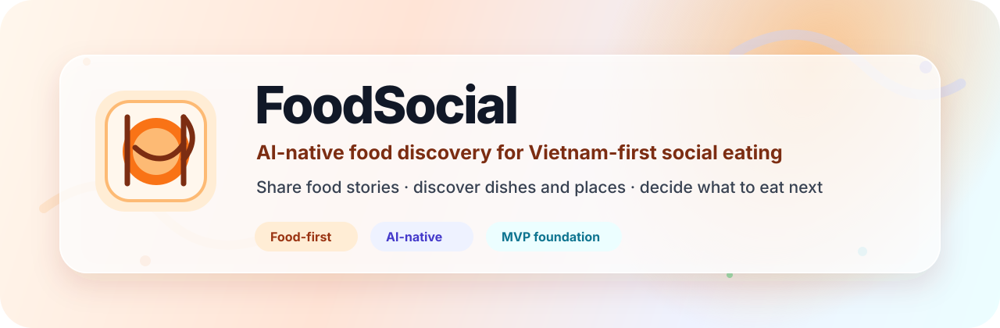
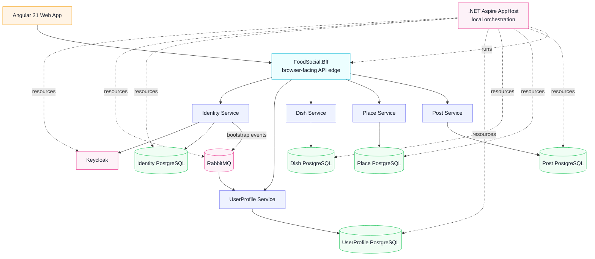

<a id="top"></a>

<div align="center">

<!-- Hero -->



# 🍜 FoodSocial

### AI-native food discovery for people who keep asking: _“What should I eat next?”_

FoodSocial is a Vietnam-first, food-only social platform for sharing food stories,
discovering dishes and places, and building toward practical AI-assisted food decisions.

<br />


<br />
<br />

<a href="#why-foodsocial"><strong>Why</strong></a> ·
<a href="#product-surface"><strong>Product</strong></a> ·
<a href="#architecture"><strong>Architecture</strong></a> ·
<a href="#quick-start"><strong>Quick Start</strong></a> ·
<a href="#documentation"><strong>Docs</strong></a>

<br />
<br />

<table>
  <tr>
    <td align="center"><strong>🍽️ Food-first</strong><br />Dishes and places are core entities, not tags.</td>
    <td align="center"><strong>🧠 AI-native</strong><br />Designed for discovery, recommendations, and agent-friendly APIs.</td>
    <td align="center"><strong>🇻🇳 Vietnam launch</strong><br />Built around a focused first market and real beta learning.</td>
  </tr>
</table>

</div>

---

## Contents

- [Why FoodSocial](#why-foodsocial)
- [Product Surface](#product-surface)
- [Build Status](#build-status)
- [Technology](#technology)
- [Architecture](#architecture)
- [Repository Map](#repository-map)
- [Quick Start](#quick-start)
- [Validation](#validation)
- [Documentation](#documentation)
- [Contributing](#contributing)

---

## Why FoodSocial

General social platforms are noisy. Map apps are place-first. Short-form video is inspiring, but not always retrievable or trustworthy when someone simply wants to decide what to eat.

FoodSocial narrows the product around a food decision loop:

```text
Share a food experience → structure dish/place signals → discover better options → decide what to eat
```

The product direction is a responsive web product where users can publish food posts, discover dishes and places, follow people, save useful content, and progressively receive AI-assisted recommendations. The engineering direction intentionally keeps domain boundaries explicit so FoodSocial can grow without losing the distinction between posts, dishes, places, profiles, search, moderation, and AI-assisted discovery.

> Current stage: **product baseline in progress**. Identity, UserProfile, Dish, Place, Post, BFF, AppHost orchestration, Angular product surfaces, CI, and starter ops assets are present. Production launch still depends on environment-owned readiness gates.

---

## Product Surface

<table>
  <tr>
    <td width="50%">
      <h3>🍱 Food posts</h3>
      <p>Structured posts about dishes, places, recipes, and memorable food experiences.</p>
    </td>
    <td width="50%">
      <h3>🔎 Discovery</h3>
      <p>A food-first discovery surface optimized for “what should I eat?” instead of generic social browsing.</p>
    </td>
  </tr>
  <tr>
    <td width="50%">
      <h3>👤 Profiles and graph</h3>
      <p>User profiles, follows, saved items, and social signals that can later improve recommendations.</p>
    </td>
    <td width="50%">
      <h3>📍 Dish and place search</h3>
      <p>PostgreSQL-first search by dish, place, area, and structured food metadata for the product baseline.</p>
    </td>
  </tr>
  <tr>
    <td width="50%">
      <h3>🧠 AI assistance</h3>
      <p>Provider-agnostic AI support for discovery, suggestions, and food decision help with deterministic fallback.</p>
    </td>
    <td width="50%">
      <h3>🛡️ Moderation</h3>
      <p>Manual-review-first moderation and reporting, preserving safety without premature automation.</p>
    </td>
  </tr>
</table>

---

## Build Status

| Area | Status |
| --- | --- |
| Backend solution | `Backend/FoodSocial.slnx` with .NET 10 source under `Backend/src/`. |
| API edge | `FoodSocial.Bff` handles browser auth/session and frontend-facing service facades. |
| Identity | Production-oriented slice with Keycloak integration, lifecycle state, RBAC, and outbox-backed bootstrap events. |
| UserProfile | Profile, follow graph, saved-item ownership APIs, persistence, and Identity bootstrap consumer path. |
| Dish, Place, and Post | Launch product slices with service-owned persistence, search, lifecycle, media, engagement, and moderation foundations. |
| Local platform | Aspire AppHost composes PostgreSQL, Redis, RabbitMQ, Keycloak, BFF, and service projects. |
| Frontend | Angular 21 app with auth-aware shell, lazy route areas, TailwindCSS, and profile UX foundation. |
| Ops | CI, release/deploy starters, observability assets, Helm, and Kubernetes templates exist; production rollout remains environment-owned. |

Read the live snapshot in [`docs/context/current_build_status.md`](./docs/context/current_build_status.md).

---

## Technology

<div align="center">

| Frontend | Backend | Platform | Operations |
| --- | --- | --- | --- |
| Angular 21 | .NET 10 | .NET Aspire | GitHub Actions |
| TypeScript | ASP.NET Core | PostgreSQL per service | Kubernetes templates |
| TailwindCSS v4 | BFF/API edge | Keycloak | Prometheus starter config |
| Standalone components | Service layering | RabbitMQ | Grafana starter dashboard |
| Signals for local state | Shared contracts | Redis available selectively | OTLP collector starter config |

</div>

Architecture principles:

- **Food-first domain:** `Dish` and `Place` remain first-class product concepts.
- **BFF edge:** browser-facing auth and frontend aggregation stay at the edge.
- **Service-owned persistence:** PostgreSQL is the source of truth per service boundary.
- **Hybrid integration:** REST for synchronous service calls; RabbitMQ for async workflows.
- **Pragmatic AI:** provider-agnostic integration with graceful deterministic fallback.
- **Product restraint:** PostgreSQL-first search, selective caching, lightweight feature controls, manual-review-first moderation.

---

## Architecture



<details>
<summary><strong>Architecture notes</strong></summary>

- The BFF is the browser-facing contract boundary and owns auth-aware request shaping.
- Identity, UserProfile, Dish, Place, and Post have launch product foundations.
- RabbitMQ is the async backbone for current event paths.
- Redis is a selective cache and is not a source of truth.
- Kubernetes assets are starters; production infrastructure remains operator-owned.

</details>

Canonical architecture detail lives in [`docs/project-discovery/10_architecture.md`](./docs/project-discovery/10_architecture.md).

---

## Repository Map

```text
FoodSocial/
├── Backend/
│   ├── FoodSocial.slnx
│   ├── src/
│   │   ├── FoodSocial.AppHost/          # Aspire local orchestration
│   │   ├── FoodSocial.Bff/              # Browser-facing API edge
│   │   ├── FoodSocial.Contracts/        # Shared integration contracts
│   │   ├── FoodSocial.ServiceDefaults/  # Shared service defaults
│   │   ├── Identity/                    # Identity service layers
│   │   ├── UserProfile/                 # Profile, graph, saved items
│   │   ├── Dish/                        # Dish service layers
│   │   ├── Place/                       # Place service layers
│   │   └── Post/                        # Post service layers
│   └── tests/                           # Backend tests
├── Frontend/                            # Angular 21 workspace
├── docs/
│   ├── project-discovery/               # Product and architecture truth
│   ├── context/                         # Current implementation state
│   └── ai/                              # Repo and agent engineering rules
├── openspec/                            # Structured change workflow
├── ops/                                 # Observability and Kubernetes starters
└── .github/workflows/ci.yml             # CI workflow
```

---

## Quick Start

### Prerequisites

| Tool | Version / note |
| --- | --- |
| .NET SDK | 10.0.x |
| Node.js | 24.x, matching CI |
| npm | Lockfile-managed; `Frontend/package.json` declares npm 11.5.1 |
| Docker Desktop | Required for local AppHost resources and AppHost-backed tests |

### 1. Run the local platform

```bash
git clone https://github.com/NCHzzz/FoodSocial.git
cd FoodSocial

dotnet restore Backend/FoodSocial.slnx
dotnet run --project Backend/src/FoodSocial.AppHost/FoodSocial.AppHost.csproj
```

The Aspire AppHost composes PostgreSQL databases, Redis, RabbitMQ, Keycloak realm bootstrap, BFF, and service projects for local development.

### 2. Run the web app

```bash
cd Frontend
npm ci
npm start
```

Open <http://localhost:4200>. Browser auth flows require the AppHost stack because Angular proxies auth routes through the BFF.

---

## Validation

### Backend

```bash
dotnet restore Backend/FoodSocial.slnx
dotnet build Backend/FoodSocial.slnx --configuration Release --no-restore
dotnet test Backend/tests/FoodSocial.Bff.Tests/FoodSocial.Bff.Tests.csproj --configuration Release --no-restore
dotnet test Backend/tests/Identity/Domain.Tests/FoodSocial.Identity.Domain.Tests.csproj --configuration Release --no-restore
dotnet test Backend/tests/Identity/Application.Tests/FoodSocial.Identity.Application.Tests.csproj --configuration Release --no-restore
dotnet test Backend/tests/Identity/Api.Tests/FoodSocial.Identity.Api.Tests.csproj --configuration Release --no-restore
dotnet test Backend/tests/UserProfile/Api.Tests/FoodSocial.UserProfile.Api.Tests.csproj --configuration Release --no-restore
```

### Database migrations

FoodSocial uses service-owned EF Core migrations. Read [`Backend/MIGRATIONS.md`](./Backend/MIGRATIONS.md) only when generating, applying, reviewing, or troubleshooting backend database migrations.

### Frontend

```bash
cd Frontend
npm ci
npm test -- --watch=false
npm run build
```

### Optional AppHost integration suite

Requires Docker and local container resources:

```bash
dotnet test Backend/tests/FoodSocial.AppHost.Tests/FoodSocial.AppHost.Tests.csproj --configuration Release --no-restore
```

---

## Documentation

| Start here | Why it matters |
| --- | --- |
| [`docs/project-discovery/00_project_overview.md`](./docs/project-discovery/00_project_overview.md) | Product goals, launch market, stack snapshot, and staged maturity direction. |
| [`docs/project-discovery/03_product_scope.md`](./docs/project-discovery/03_product_scope.md) | In-scope and out-of-scope product boundaries. |
| [`docs/project-discovery/04_functional_requirements.md`](./docs/project-discovery/04_functional_requirements.md) | Product behavior requirements. |
| [`docs/project-discovery/07_domain_model.md`](./docs/project-discovery/07_domain_model.md) | Core entities and domain relationships. |
| [`docs/project-discovery/10_architecture.md`](./docs/project-discovery/10_architecture.md) | Architecture decisions, trade-offs, and deferred complexity. |
| [`docs/context/current_build_status.md`](./docs/context/current_build_status.md) | Current implementation state and blockers. |
| [`Frontend/README.md`](./Frontend/README.md) | Frontend workspace setup and structure. |
| [`ops/README.md`](./ops/README.md) | Starter operational assets. |

---

## Contributing

FoodSocial is currently a personal product build. Contributions should preserve the project-discovery truth and current architecture direction.

Before changing implementation:

1. Read [`AGENTS.md`](./AGENTS.md), [`docs/ai/repo-map.md`](./docs/ai/repo-map.md), and [`docs/ai/workflows.md`](./docs/ai/workflows.md).
2. Keep repository markdown in English.
3. Do not introduce product behavior that is not approved in `docs/project-discovery/`.
4. Keep `Dish` and `Place` as first-class entities.
5. Run the relevant validation commands before opening a pull request.

---

<div align="center">

Built with .NET, Angular, PostgreSQL, RabbitMQ, Keycloak, and practical product restraint.

Inspired by [`awesome-readme`](https://github.com/matiassingers/awesome-readme).

<br />

[Back to top](#top)

</div>
