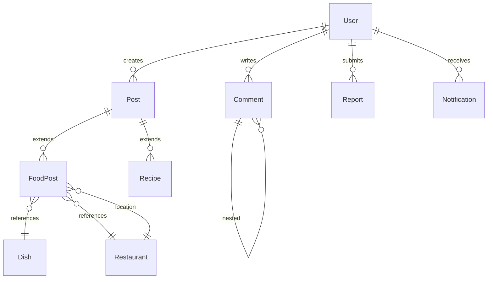

# Data Model & Domain Overview

## Status

- Working draft
- Last updated: 2026-04-02

## Overview

This document consolidates the detailed **Data Model** (previously in `07_data_model.md`) with the high‑level **Domain Model** (previously in this file). It defines the core entities, their attributes, relationships, and the MVP modeling direction for FoodSocial.

---

### Core Entities (Detailed)

#### User
```json
{
  "id": "uuid",
  "username": "string",
  "email": "string",
  "displayName": "string",
  "avatarUrl": "string",
  "bio": "string",
  "tasteProfile": {
    "preferredCuisines": ["string"],
    "dislikedIngredients": ["string"],
    "dietaryRestrictions": ["string"]
  },
  "role": "enum: guest | user | admin",
  "status": "enum: active | suspended | deleted",
  "createdAt": "datetime",
  "updatedAt": "datetime"
}
```

#### Post (base)
```json
{
  "id": "uuid",
  "type": "enum: food | restaurant | recipe",
  "authorId": "uuid",
  "caption": "string",
  "media": [{
    "type": "enum: image | video",
    "url": "string",
    "thumbnailUrl": "string",
    "caption": "string"
  }],
  "tags": ["string"],
  "location": {
    "latitude": "float",
    "longitude": "float",
    "address": "string",
    "city": "string",
    "country": "string"
  },
  "engagement": {
    "likes": "integer",
    "comments": "integer",
    "shares": "integer",
    "saves": "integer"
  },
  "status": "enum: published | hidden | deleted",
  "createdAt": "datetime",
  "updatedAt": "datetime"
}
```

#### FoodPost (extends Post)
```json
{
  "id": "uuid", // References Post.id
  "dishName": "string",
  "dishId": "uuid", // References Dish.id
  "restaurantId": "uuid", // References Restaurant.id
  "rating": "integer (1-5)",
  "priceRange": "enum: $ | $$ | $$$ | $$$$",
  "tasteNotes": ["string"]
}
```

#### Restaurant
```json
{
  "id": "uuid",
  "name": "string",
  "description": "string",
  "address": "string",
  "location": {"latitude": "float", "longitude": "float"},
  "cuisineTypes": ["string"],
  "priceRange": "enum: $ | $$ | $$$ | $$$$",
  "operatingHours": {"monday": {"open": "time", "close": "time"}, "tuesday": {"open": "time", "close": "time"}},
  "contact": {"phone": "string", "website": "string", "email": "string"},
  "rating": {"average": "float", "count": "integer"},
  "status": "enum: active | closed | suspended",
  "createdAt": "datetime",
  "updatedAt": "datetime"
}
```

#### Dish
```json
{
  "id": "uuid",
  "name": "string",
  "description": "string",
  "category": "string",
  "cuisine": "string",
  "ingredients": ["string"],
  "dietaryInfo": {"isVegetarian": "boolean", "isVegan": "boolean", "isGlutenFree": "boolean", "isSpicy": "boolean"},
  "nutrition": {"calories": "integer", "protein": "float", "carbs": "float", "fat": "float"},
  "status": "enum: active | deprecated",
  "createdAt": "datetime"
}
```

#### Recipe (extends Post)
```json
{
  "id": "uuid", // References Post.id
  "servings": "integer",
  "prepTime": "integer (minutes)",
  "cookTime": "integer (minutes)",
  "ingredients": [{"item": "string", "quantity": "string", "unit": "string", "notes": "string"}],
  "instructions": [{"step": "integer", "instruction": "string", "mediaUrl": "string"}],
  "difficulty": "enum: easy | medium | hard",
  "tags": ["string"]
}
```

#### Comment
```json
{
  "id": "uuid",
  "postId": "uuid",
  "parentId": "uuid",
  "authorId": "uuid",
  "content": "string",
  "status": "enum: visible | hidden | deleted",
  "createdAt": "datetime",
  "updatedAt": "datetime"
}
```

#### Report
```json
{
  "id": "uuid",
  "reporterId": "uuid",
  "targetType": "enum: post | user | comment",
  "targetId": "uuid",
  "reason": "enum: spam | inauthentic | abuse | illegal | other",
  "description": "string",
  "status": "enum: submitted | under_review | resolved_no_action | resolved_content_action | resolved_user_action",
  "moderatorId": "uuid",
  "resolution": "string",
  "createdAt": "datetime",
  "resolvedAt": "datetime"
}
```

#### Notification
```json
{
  "id": "uuid",
  "userId": "uuid",
  "type": "enum: like | comment | follow | share | save | system",
  "title": "string",
  "message": "string",
  "data": "json",
  "isRead": "boolean",
  "createdAt": "datetime"
}
```

---

### High‑Level Domain Model (MVP Direction)

- **Post** is the central aggregate with a `contentType` field (`food`, `restaurant`, `recipe`).
- **Dish** and **Place** are first‑class entities from day 1; food posts must reference a canonical `Dish`, and may reference a canonical `Place` when known.
- **User** owns posts, likes, comments, follows, and saved items.
- **Tenant** isolation is enforced at the service layer (not a separate domain entity for MVP).
- Aggregates:
  - `User/Profile`
  - `Post` (including `FoodPost`, `RecipePost`)
  - `Dish`
  - `Place`
  - `Moderation` (reports, actions)

---

### Entity Relationships (Mermaid ER Diagram)



---

### Indexing Strategy (summary)
- Primary keys: `id` (UUID) for all tables.
- Unique indexes: `User.username`, `User.email`.
- Search indexes: full‑text on `Post.caption`, `Restaurant.name`, `Dish.name`.
- Foreign‑key indexes as described in the original `08_database_design.md`.

---

*This unified document replaces both `07_data_model.md` and the previous `07_domain_model.md`. The original `07_data_model.md` can be removed as its content is now incorporated here.*