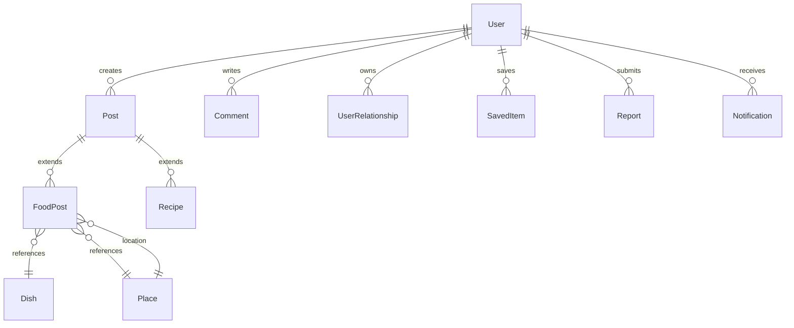

# Data Model & Domain Overview

## Status

- Working draft
- Last updated: 2026-05-13

## Overview

This document defines the core entities, their attributes, relationships, and the launch modeling direction for FoodSocial.

---

### Core Entities (Detailed)

#### User
```json
{
  "id": "uuid",
  "identitySubject": "string",
  "username": "string",
  "email": "string",
  "displayName": "string",
  "avatarUrl": "string",
  "bio": "string",
  "tasteProfile": {
    "preferredCuisines": ["string"],
    "dislikedIngredients": ["string"],
    "dietaryRestrictions": ["string"]
  },
  "roles": ["user", "moderator", "admin"],
  "status": "enum: active | restricted | suspended | deleted",
  "createdAt": "datetime",
  "updatedAt": "datetime"
}
```

#### Post (base)
```json
{
  "id": "uuid",
  "type": "enum: food | restaurant | recipe",
  "authorId": "uuid",
  "caption": "string",
  "media": [{
    "type": "enum: image | video_later",
    "url": "string",
    "thumbnailUrl": "string",
    "caption": "string"
  }],
  "tags": ["string"],
  "location": {
    "latitude": "float",
    "longitude": "float",
    "address": "string",
    "city": "string",
    "country": "string"
  },
  "engagement": {
    "likes": "integer",
    "comments": "integer",
    "shares": "integer",
    "saves": "integer"
  },
  "status": "enum: published | hidden | deleted",
  "createdAt": "datetime",
  "updatedAt": "datetime"
}
```

#### FoodPost (extends Post)
```json
{
  "id": "uuid", // References Post.id
  "dishName": "string",
  "dishId": "uuid", // References Dish.id
  "placeId": "uuid | null", // References Place.id when known
  "rating": "integer (1-5)",
  "priceRange": "enum: $ | $$ | $$$ | $$$$",
  "tasteNotes": ["string"]
}
```

#### Place
```json
{
  "id": "uuid",
  "name": "string",
  "description": "string",
  "address": "string",
  "city": "string",
  "area": "string",
  "location": {"latitude": "float", "longitude": "float"},
  "cuisineTypes": ["string"],
  "priceRange": "enum: $ | $$ | $$$ | $$$$",
  "status": "enum: active | closed | suspended",
  "createdAt": "datetime",
  "updatedAt": "datetime"
}
```

#### Dish
```json
{
  "id": "uuid",
  "name": "string",
  "description": "string",
  "aliases": ["string"],
  "category": "string",
  "cuisine": "string",
  "status": "enum: active | deprecated",
  "createdAt": "datetime",
  "updatedAt": "datetime"
}
```

#### Recipe (extends Post)
```json
{
  "id": "uuid", // References Post.id
  "servings": "integer",
  "prepTime": "integer (minutes)",
  "cookTime": "integer (minutes)",
  "ingredients": [{"item": "string", "quantity": "string", "unit": "string", "notes": "string"}],
  "instructions": [{"step": "integer", "instruction": "string", "mediaUrl": "string"}],
  "difficulty": "enum: easy | medium | hard",
  "tags": ["string"]
}
```

#### Comment
```json
{
  "id": "uuid",
  "postId": "uuid",
  "authorId": "uuid",
  "content": "string",
  "status": "enum: visible | hidden | deleted",
  "createdAt": "datetime",
  "updatedAt": "datetime"
}
```

#### UserRelationship
```json
{
  "id": "uuid",
  "sourceUserId": "uuid",
  "targetUserId": "uuid",
  "type": "enum: follow | block | mute",
  "status": "enum: active | removed",
  "createdAt": "datetime",
  "updatedAt": "datetime"
}
```

#### SavedItem
```json
{
  "id": "uuid",
  "userId": "uuid",
  "targetType": "enum: post | dish | place",
  "targetId": "uuid",
  "createdAt": "datetime"
}
```

#### Report
```json
{
  "id": "uuid",
  "reporterId": "uuid",
  "targetType": "enum: post | user | comment",
  "targetId": "uuid",
  "reason": "enum: spam | inauthentic | abuse | illegal | other",
  "description": "string",
  "status": "enum: submitted | under_review | resolved_no_action | resolved_content_action | resolved_user_action",
  "moderatorId": "uuid",
  "resolution": "string",
  "createdAt": "datetime",
  "resolvedAt": "datetime"
}
```

#### Notification
```json
{
  "id": "uuid",
  "userId": "uuid",
  "type": "enum: like | comment | follow | repost | report_outcome | account | system",
  "title": "string",
  "message": "string",
  "data": "json",
  "isRead": "boolean",
  "createdAt": "datetime",
  "readAt": "datetime | null"
}
```

---

### High-Level Domain Model (Launch Direction)

- **Dish** and **Place** are first-class entities from day 1.
- Food posts must reference a canonical `Dish`, and may reference a canonical `Place` when known.
- Place fallback text may exist for launch posting, but canonical `Place` remains the preferred link for search and discovery quality.
- `Post` is the central content aggregate.
- `User/Profile` owns profile state, follows, blocks, mutes, and saved items.
- Tenant isolation is enforced at the service layer rather than as a separate product-facing domain entity until tenant workflows become part of the business model.
- Aggregates:
  - `User/Profile`
  - `Post` (including `FoodPost`, `RecipePost`)
  - `Dish`
  - `Place`
  - `Media`
  - `Moderation` (reports, actions)
  - `Notification`
  - `Analytics/Event`

---

### Entity Relationships (Mermaid ER Diagram)



---

### Indexing Strategy (summary)

Canonical schema/index detail lives in `09_database_design.md`.

Only the highest-value summary remains here:

- primary keys use UUIDs
- `User.username` and `User.email` are unique
- search indexes matter on `Post.caption`, `Place.name`, and `Dish.name`
- relationship indexes matter on `(sourceUserId, targetUserId, type)` and target-user lookup paths
- saved-item indexes matter on `(userId, targetType, targetId)`

---

This is the canonical domain-model document for current product and API-facing entity discussion.
